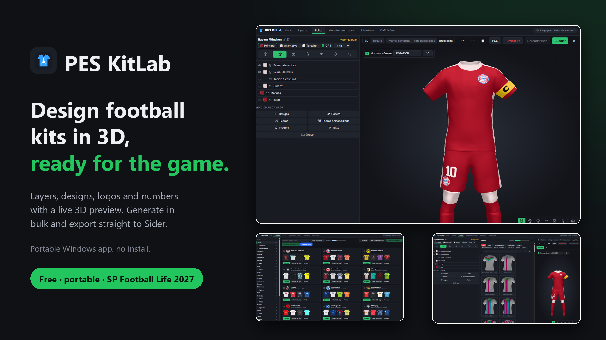
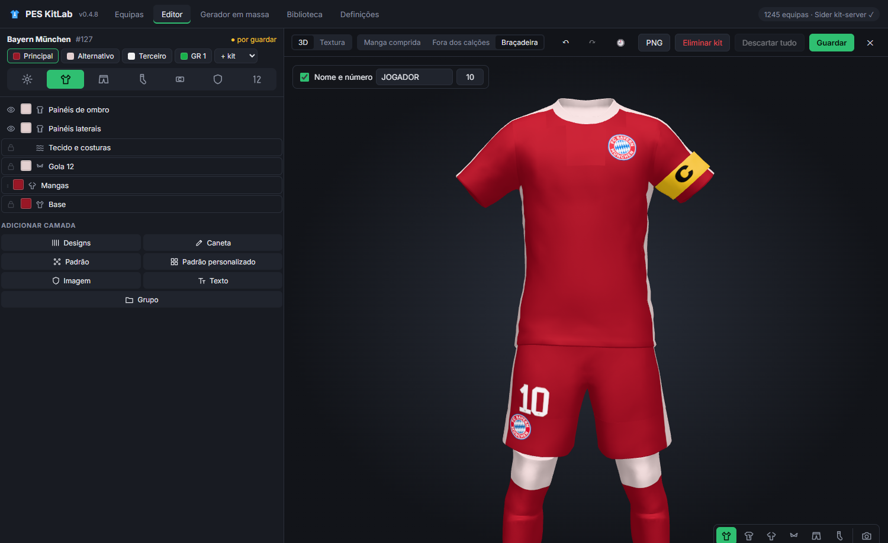
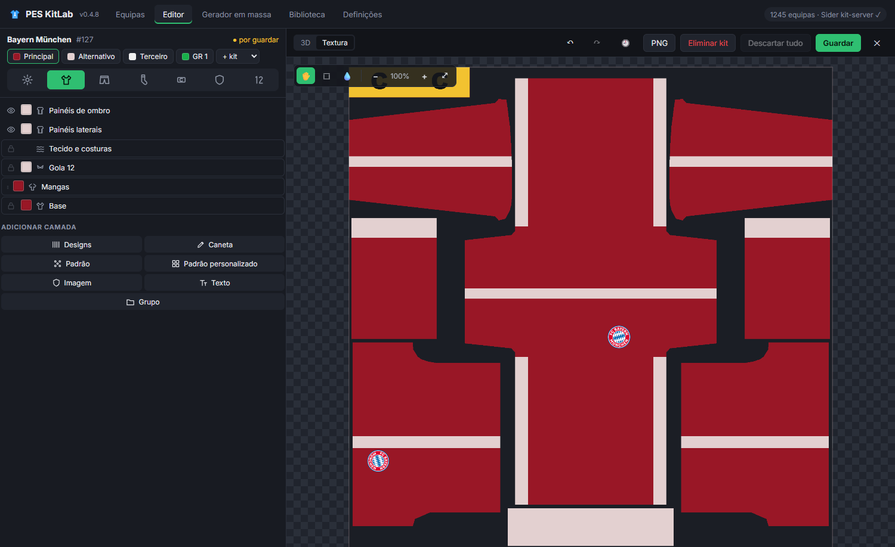
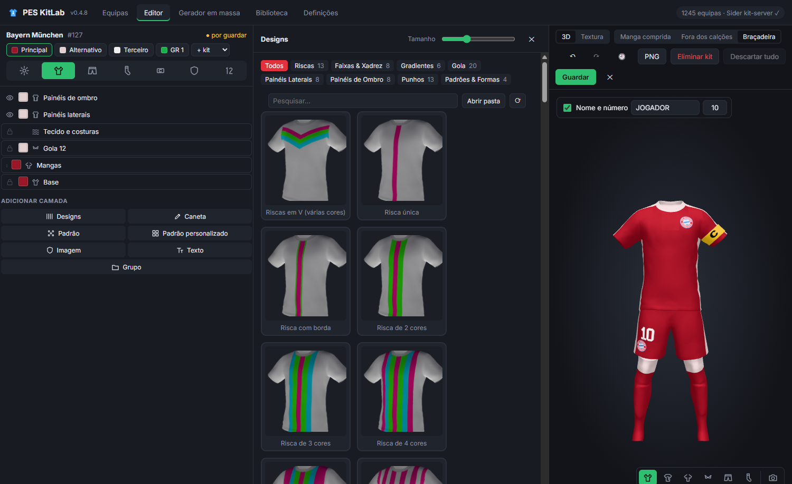
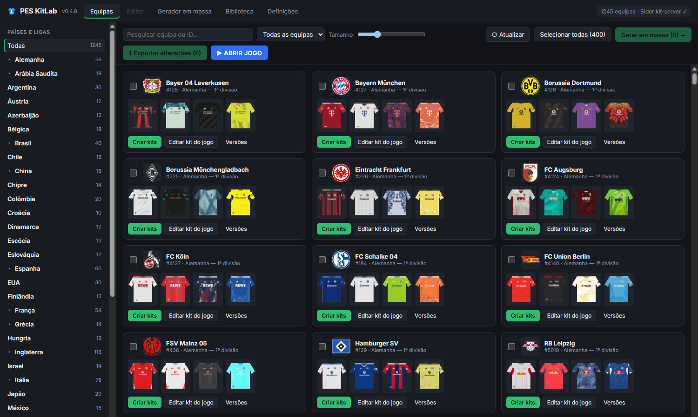

<div align="center">



**Design football kits with a live 3D preview and export them straight to the game.**<br>
A portable Windows app for SP Football Life 2027 (PES 2021 base) and Sider's kit-server.

<a href="https://github.com/bacoinz/PES-KitLab/releases/latest"></a> <a href="LICENSE.md"></a>    <a href="https://ko-fi.com/bacoinz"></a> <a href="https://github.com/sponsors/bacoinz"></a>

[Download](https://github.com/bacoinz/PES-KitLab/releases/latest) · [Features](#features) · [How to use](#how-to-use) · [Build from source](#build-from-source) · [Changelog](CHANGELOG.md) · [🇵🇹 Português](README.pt-PT.md)

</div>

> [!NOTE]
> **The interface is written in European Portuguese and translated to English and Spanish.** Pick the language in Settings → General.

## Why PES KitLab

Making a kit for the game usually means editing a 2048×2048 texture in an image editor, guessing where each seam lands on the 3D model, converting the result to FTEX and copying files around by hand.

PES KitLab does the whole chain:
- It reads the teams of your game and the kits they already have.
- You design on the 2D texture or the 3D model, with layers, and see both at the same time.
- It exports to Sider's kit-server in one click, and restoring the original is one more.

It only ever writes its own files, so removing everything it did takes one button.

## Features

**Editor**

- **Layers, like in a graphics editor:** drag to reorder, groups, masks (any layer, a group or the sleeves), lock, opacity, 16 blend modes, blur, mirror, rotation, offset and size on every layer. Undo history of up to 300 steps.
- **Designs menu with 3D previews:** stripes, hoops, bands, checks, gradients, zig-zag, waves, panels (sides, shoulders, cuffs, hems), 133 collar models and your own graphics and patterns.
- **Collars, sleeves and panels measured on the game's models:** shoulder panels that run to the cuff, sleeves with or without shoulders, symmetric collar designs on both faces.
- **Text, vector pen, custom patterns and images,** with a background remover and a monochrome logo tool.
- **Per-layer stitching** and fabric on the shirt, shorts and socks, with shine for the 3D preview.
- **Colour picker** with kit/team/saved palettes, transparency and an eyedropper that works anywhere on screen.

**Interface**

- A start screen with the logo and version: it asks for the game folder only the first time, then shows the loading steps.
- A footer with the GitHub repository, other projects and credits, also at the bottom of Settings.

**Logos and numbers**

- Club crest, brand, sponsors, shorts and socks logos with their own position, size and rotation.
- Name and number with the game's fonts, PC fonts or your own FTEX sets, with outline and recolouring.
- Captain's armband, with its own pattern and 3D fit.
- "Add to the other kits" and "copy to all kits" on every logo.

**3D view**

- Uses the game's own shirt, sleeves and collar models, tucked in or out, long sleeves, armband.
- 12 light presets, three environments, transparent or coloured background, snapshot to PNG.

**Teams and export**

- Reads every team of the game (1,000+), shows their current kits and lets you edit the in-game kit.
- **Bulk generation:** pick many teams, choose templates (45 included, plus your own) and create all their kits with each team's colours.
- Exports to the kit-server with versions, restore original, zip export and 512 to 4096 px textures.
- Warns you when a team comes from a pack whose kits the Sider kit-server will disable.

## Screenshots

<table>
  <tr>
    <td width="50%"></td>
    <td width="50%"></td>
  </tr>
  <tr>
    <td></td>
    <td></td>
  </tr>
</table>

## How to use

1. Download `PES-KitLab-<version>-portable.exe` from the [latest release](https://github.com/bacoinz/PES-KitLab/releases/latest) and put it in a folder you can write to. Your data goes in a `KitCreatorData` folder next to it.
2. Open it and point it to your game folder.
3. Pick a team, press **Criar kits** (or **Editar kit do jogo**) and design.
4. Press **Exportar alterações**. The app writes the kits to Sider's kit-server (`SiderAddons\content\kits`) and adds its own section at the end of `map.txt`.
5. Press **ABRIR JOGO**.

> [!IMPORTANT]
> Teams created by a **FL26 Mod Studio** pack generated with "Kits you can edit in the game" have no licensed kit, so Sider's `kits.lua` turns the kit-server off for them ("team is unlicensed"). Generate the pack without that option. PES KitLab shows a warning for these teams.

To go back to the original kits, use "Restore original" in the team's versions. It deletes only what PES KitLab created.

## Build from source

You need Node 22+, Rust (stable, MSVC toolchain) and the Tauri 2 prerequisites for Windows (WebView2).

```bash
cd app-tauri
npm install
npx tsc --noEmit                      # typecheck
cd src-tauri && cargo test --release  # Rust tests (they read the real game, read-only)
cd .. && npx tauri build --no-bundle  # exe in src-tauri/target/release/
npm run dist                          # bump the patch version and copy a portable exe to dist-portable/
```

## How it works

| Part | What it uses |
|---|---|
| App shell and game access | **Tauri 2 + Rust** (CPK / CRILAYLA, FTEX, FMDL, kit-server files) |
| Texture compositor | **WebGL2** (one pass per layer, masks, 16 blend modes), runs in about 5 ms per change |
| 3D view | **three.js** with GLB models exported from the Comet template |
| Interface | **React + TypeScript + Vite**, zustand |
| Texture encoding | **BC7 / DXT** with `intel_tex_2`, in parallel with `rayon` |

The 2D texture is the source of truth and the 3D view only wraps it, so what you see is what the game gets.

```
app-tauri/src-tauri/   Rust core: game files (cpk, tex, fmdl), teams, kit-server, export
app-tauri/src/         compositor/ (2D), three/ (3D), model/ (kit data, templates), ui/
app-tauri/scripts/     Blender script that exports the 3D models
app-tauri/public/      3D models, 2D template, logo
docs/                  Design notes and screenshots
```

## Credits

- 3D models exported from the **CometKITpreviewer** Blender template.
- Works with [Sider](https://github.com/juce/sider) and its kit-server by juce.
- Texture decoding by [`texture2ddecoder`](https://crates.io/crates/texture2ddecoder) and encoding by [`intel_tex_2`](https://crates.io/crates/intel_tex_2).
- PES KitLab is an independent fan tool, not affiliated with Konami or any club. Club names and crests shown in the screenshots belong to their owners.

If it saves you time, you can [buy me a coffee on Ko-fi](https://ko-fi.com/bacoinz).

## License

[PolyForm Noncommercial 1.0.0](LICENSE.md). Free of charge, you can use it, change it and share your kits:
- for yourself, your community or your save files;
- for a school or a non-profit.

Selling the app, or selling access to it, is not allowed. For anything commercial, ask the author.
