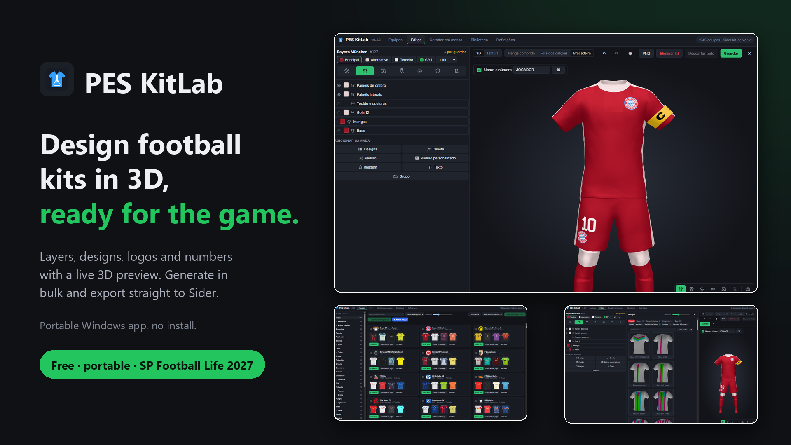
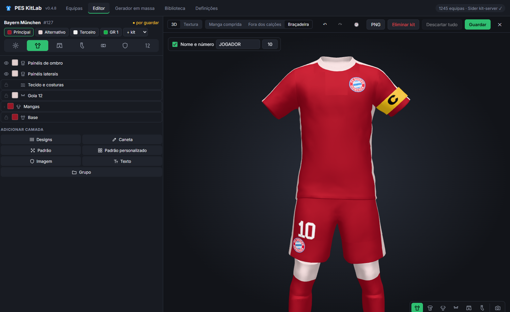
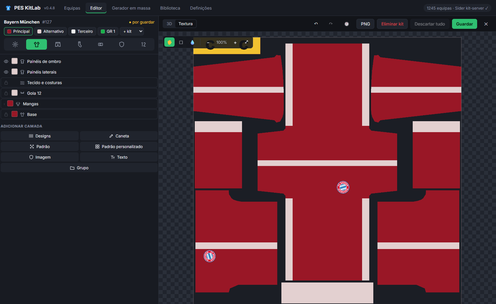
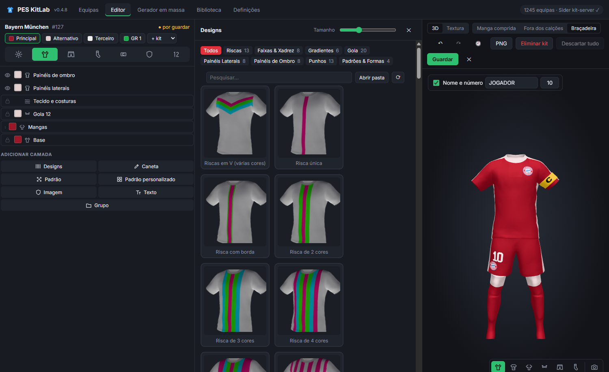
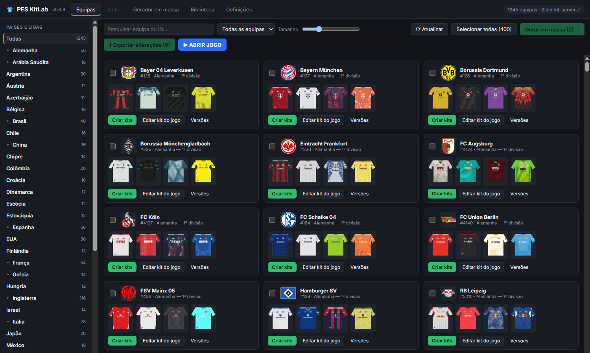

<div align="center">



**Cria equipamentos de futebol com pré-visualização 3D e exporta-os direto para o jogo.**<br>
App portátil para Windows para o SP Football Life 2027 (base PES 2021) e o kit-server do Sider.

<a href="https://github.com/bacoinz/PES-KitLab/releases/latest"></a> <a href="LICENSE.md"></a>    <a href="https://ko-fi.com/bacoinz"></a> <a href="https://github.com/sponsors/bacoinz"></a>

[Descarregar](https://github.com/bacoinz/PES-KitLab/releases/latest) · [O que faz](#o-que-faz) · [Como usar](#como-usar) · [Compilar](#compilar) · [Changelog](CHANGELOG.md) · [🇬🇧 English](README.md)

</div>

> [!NOTE]
> **A interface está escrita em português de Portugal e traduzida para inglês e espanhol.** Escolhe a língua em Definições → Geral.

## Porquê o PES KitLab

Fazer um equipamento para o jogo costuma ser editar uma textura de 2048×2048 num editor de imagem, adivinhar onde cai cada costura no modelo 3D, converter para FTEX e copiar ficheiros à mão.

O PES KitLab faz a cadeia toda:
- Lê as equipas do teu jogo e os kits que já têm.
- Desenhas na textura 2D ou no modelo 3D, com camadas, e vês os dois ao mesmo tempo.
- Exporta para o kit-server do Sider com um clique, e repor o original é mais um.

Só escreve os ficheiros que são dele, por isso desfazer tudo é um botão.

## O que faz

**Editor**

- **Camadas, como num editor gráfico:** arrastar para ordenar, grupos, máscaras (uma camada, um grupo ou as mangas), cadeado, opacidade, 16 modos de mistura, desfoque, espelho, rotação, deslocamento e tamanho em todas as camadas. Histórico de anular até 300 passos.
- **Menu Designs com pré-visualizações 3D:** riscas, listas, faixas, xadrez, degradês, zigue-zague, ondas, painéis (laterais, ombros, punhos, bainhas), 133 modelos de gola e os teus gráficos e padrões.
- **Golas, mangas e painéis medidos nos modelos do jogo:** painéis de ombro até ao punho, mangas com ou sem ombros, designs de gola simétricos nas duas faces.
- **Texto, caneta vetorial, padrões e imagens próprias,** com remover fundo e logo monocromático.
- **Costuras por camada** e tecido na camisola, calções e meias, com brilho na pré-visualização 3D.
- **Seletor de cor** com paletas do kit/equipa/guardadas, transparência e conta-gotas que funciona em qualquer sítio do ecrã.

**Interface**

- Um ecrã inicial com o logo e a versão: pede a pasta do jogo só à primeira vez e depois mostra os passos do carregamento.
- Um rodapé com o repositório do GitHub, outros projetos e créditos, também no fim das Definições.

**Logos e números**

- Emblema do clube, marca, patrocínios, logos dos calções e das meias, cada um com posição, tamanho e rotação.
- Nome e número com as fontes do jogo, do PC ou os teus conjuntos FTEX, com contorno e recolorir.
- Braçadeira de capitão, com padrão próprio e ajuste 3D.
- "Adicionar aos outros kits" e "copiar para todos os kits" em cada logo.

**Vista 3D**

- Usa os modelos de camisola, mangas e gola do próprio jogo, por dentro ou por fora dos calções, manga comprida, braçadeira.
- 12 predefinições de luz, três ambientes, fundo transparente ou com cor, guardar imagem em PNG.

**Equipas e exportação**

- Lê todas as equipas do jogo (mais de mil), mostra os kits atuais e deixa editar o kit do jogo.
- **Geração em massa:** escolhes várias equipas e templates (45 incluídos, mais os teus) e cria todos os kits com as cores de cada equipa.
- Exporta para o kit-server com versões, repor original, zip e texturas de 512 a 4096 px.
- Avisa quando uma equipa vem de um pack cujos kits o kit-server do Sider vai desligar.

## Capturas de ecrã

<table>
  <tr>
    <td width="50%"></td>
    <td width="50%"></td>
  </tr>
  <tr>
    <td></td>
    <td></td>
  </tr>
</table>

## Como usar

1. Descarrega `PES-KitLab-<versão>-portable.exe` da [última versão](https://github.com/bacoinz/PES-KitLab/releases/latest) e põe-no numa pasta onde possas escrever. Os teus dados ficam numa pasta `KitCreatorData` ao lado.
2. Abre-o e indica a pasta do jogo.
3. Escolhe uma equipa, carrega em **Criar kits** (ou **Editar kit do jogo**) e desenha.
4. Carrega em **Exportar alterações**. A app escreve os kits no kit-server do Sider (`SiderAddons\content\kits`) e acrescenta a sua secção no fim do `map.txt`.
5. Carrega em **ABRIR JOGO**.

> [!IMPORTANT]
> As equipas criadas por um pack do **FL26 Mod Studio** gerado com "Kits you can edit in the game" não têm kit licenciado, e o `kits.lua` do Sider desliga o kit-server para elas ("team is unlicensed"). Gera o pack sem essa opção. O PES KitLab mostra um aviso nestas equipas.

Para voltar aos kits originais, usa "Repor original" nas versões da equipa. Só apaga o que o PES KitLab criou.

## Compilar

Precisas de Node 22+, Rust (stable, toolchain MSVC) e dos pré-requisitos do Tauri 2 para Windows (WebView2).

```bash
cd app-tauri
npm install
npx tsc --noEmit                      # typecheck
cd src-tauri && cargo test --release  # testes Rust (leem o jogo real, só leitura)
cd .. && npx tauri build --no-bundle  # exe em src-tauri/target/release/
npm run dist                          # sobe a versão patch e copia um exe portátil para dist-portable/
```

## Como funciona

| Parte | O que usa |
|---|---|
| App e acesso ao jogo | **Tauri 2 + Rust** (CPK / CRILAYLA, FTEX, FMDL, ficheiros do kit-server) |
| Compositor de texturas | **WebGL2** (uma passagem por camada, máscaras, 16 modos de mistura), cerca de 5 ms por alteração |
| Vista 3D | **three.js** com modelos GLB exportados do template Comet |
| Interface | **React + TypeScript + Vite**, zustand |
| Codificação de texturas | **BC7 / DXT** com `intel_tex_2`, em paralelo com `rayon` |

A textura 2D é a fonte e o 3D só a embrulha, por isso o que vês é o que o jogo recebe.

```
app-tauri/src-tauri/   Núcleo Rust: ficheiros do jogo (cpk, tex, fmdl), equipas, kit-server, exportação
app-tauri/src/         compositor/ (2D), three/ (3D), model/ (dados do kit, templates), ui/
app-tauri/scripts/     Script Blender que exporta os modelos 3D
app-tauri/public/      Modelos 3D, template 2D, logo
docs/                  Notas de design e capturas
```

## Créditos

- Modelos 3D exportados do template Blender **CometKITpreviewer**.
- Funciona com o [Sider](https://github.com/juce/sider) e o seu kit-server, de juce.
- Descodificação de texturas com [`texture2ddecoder`](https://crates.io/crates/texture2ddecoder) e codificação com [`intel_tex_2`](https://crates.io/crates/intel_tex_2).
- O PES KitLab é uma ferramenta de fãs independente, sem ligação à Konami nem a nenhum clube. Os nomes e emblemas de clubes nas capturas pertencem aos respetivos donos.

Se te poupar tempo, podes [pagar-me um café no Ko-fi](https://ko-fi.com/bacoinz).

## Licença

[PolyForm Noncommercial 1.0.0](LICENSE.md). Grátis, podes usá-lo, alterá-lo e partilhar os teus kits:
- para ti, a tua comunidade ou os teus saves;
- numa escola ou numa organização sem fins lucrativos.

Vender a app, ou vender acesso a ela, não é permitido. Para qualquer uso comercial, fala com o autor.
